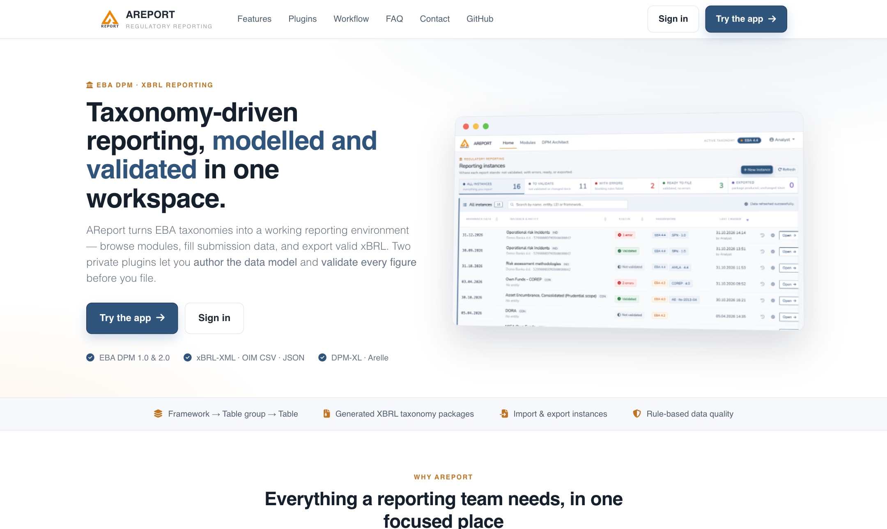

# AreportDpmXBRL

`AreportDpmXBRL` is a PHP library that reads supervisory reporting taxonomies built on the DPM/XBRL standard (EBA, EIOPA, ECB, national regulators and their extensions), renders their tables as HTML forms, and writes `xBRL-CSV` and `xBRL-XML` instances that follow the filing rules (e.g. the EBA filing rules).

It powers the [AReport](https://areport.net) web application ([source](https://github.com/begicf/areport)). It lives in its own package so the taxonomy logic can be developed and tested independently.

[](https://areport.net)

## What it covers

### Taxonomy reading
- **Entry points and table linkbases:** module entry points (`mod/*.xsd`) and table linkbases (`tab/*`) of DPM `1.0` and DPM `2.0` taxonomies, tested with EBA 4.2 and 4.4.
- **Module tree:** frameworks, taxonomy versions, modules, table groups and tables (`ModuleTree`). It includes a module that imports another owner's table by its official URL.
- **Paths and hrefs:** paths resolve across taxonomy revisions, and absolute locator hrefs resolve to the local taxonomy root.
- **Labels:** labels in several languages, preferring business labels over generic `Rows` / `Columns` placeholders.
- **Metadata and LEI:** DPM metadata from the table JSON sidecars of xBRL-CSV taxonomies (`TableJsonMetadata`), module version info (`ModuleInfo`, including the DPM 2.0 ModuleVID), and LEI check digits per ISO 17442 (`Lei::isValid`).

### Table rendering
- **Axes and ordering:** x/y/z axes with nested breakdowns. `parentChildOrder="children-first"` is honoured on both axes, rollup parents included. Sub-columns inherit their ancestors' concept, and a data column that has sub-columns keeps its own column.
- **Enabled and disabled cells:** decided by the definition linkbase (hypercubes, exact member sets). This also covers owner taxonomies, empty hypercubes, cubes of a metric plus one typed dimension, and open-axis keys without member constraints.
- **Open tables and typed z-axes:**
  - Open tables add rows with their key columns.
  - Typed z-axes become sheets named by their key value (`k:<value>`).
  - On explicit z-axes, each sheet's member QName is written in its member's domain namespace (e.g. `eba_CU:AED`).
- **Enumerations:** dropdowns that follow the hierarchy as a tree (indented options, no lost members), including members of other domains and other owners.
- **Other output formats:** HTML, `.xlsx` (PhpSpreadsheet) and `.pdf` (mPDF) through `Render::export()`.

### Instance writers
- `CreateXBRLCsvPackage` writes an `xBRL-CSV` report package (ZIP):
  - one datapoint per cell, matched on its exact dimensions;
  - a datapoint shared by two tables is reported once;
  - open-table rows carry their keys, and typed members are written flat;
  - EBA package name, parameters and filing indicators for every template of the module.
- `CreateXBRLFromDB` writes an `xBRL-XML` instance:
  - one context per member set, and one fact per concept and context;
  - `link` and `xlink` are always declared;
  - filing indicators use a qualified `find:filed`.
- Both writers take filing options through `setOptions()`: base currency, monetary scale, decimals per data type, base language, NCA country, and filing-indicator overrides.

## Installation

```bash
composer require begicf/areport-dpm-xbrl
```

For development next to AReport, clone it as a sibling folder (`../areport-dpm-xbrl`). AReport's `composer.json` links it as a symlinked path repository.

## Usage

### Render a table as an HTML form

```php
use AReportDpmXBRL\Library\Data;
use AReportDpmXBRL\Render;

$taxonomy = Data::getTax($tablePath);          // a table linkbase of the taxonomy
$render = new Render($taxonomy);

$form = $render->renderHtmlForm([
    'sheets' => '000',                         // selected z-axis sheet
    'file'   => $storedFacts,                  // facts to show in the cells
    'ext'    => 'DB',                          // source of the data: DB or XBRL
], $selectedSheet);

// $form: table, sheets, tableName, aspectNode, tableID, groups
```

### Export a rendered table

```php
$output = $render->export('xlsx');             // html | xlsx | pdf
```

### Write an xBRL-CSV report package

```php
use AReportDpmXBRL\Creat\CreateXBRLCsvPackage;

$package = (new CreateXBRLCsvPackage($period, $entityId, $modulePath, $facts, $taxonomyFolder))
    ->setOptions(['baseCurrency' => 'EUR', 'country' => 'BA'])
    ->writePackage();                          // ['path' => zip file, 'filename' => EBA package name]
```

### Write an xBRL-XML instance

```php
use AReportDpmXBRL\Creat\CreateXBRLFromDB;

$xml = (new CreateXBRLFromDB($period, $entityId, $modulePath, $facts, $filedTables, $taxonomyFolder))
    ->setOptions(['baseCurrency' => 'EUR'])
    ->writeXbrl();
```

## Development notes

- Keep DPM `1.0` behaviour stable while extending DPM `2.0` support, and check changes against old and new taxonomy packages.
- AReport keeps a render baseline of 10 EBA tables. A rendering change should leave it unchanged unless the change is intended.

## Related repositories

- AReport: <https://areport.net> · source: <https://github.com/begicf/areport>
- Package repository: <https://github.com/begicf/areport-dpm-xbrl>
